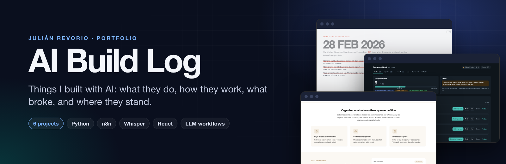
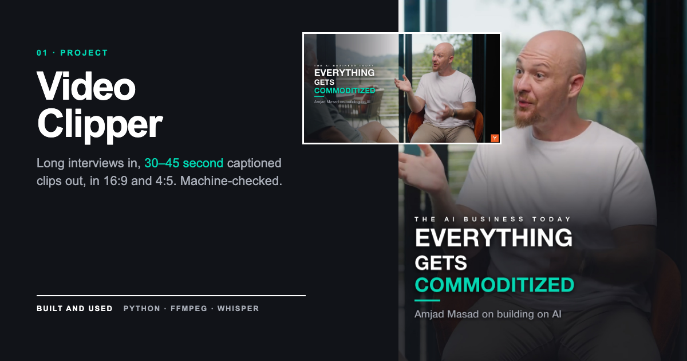
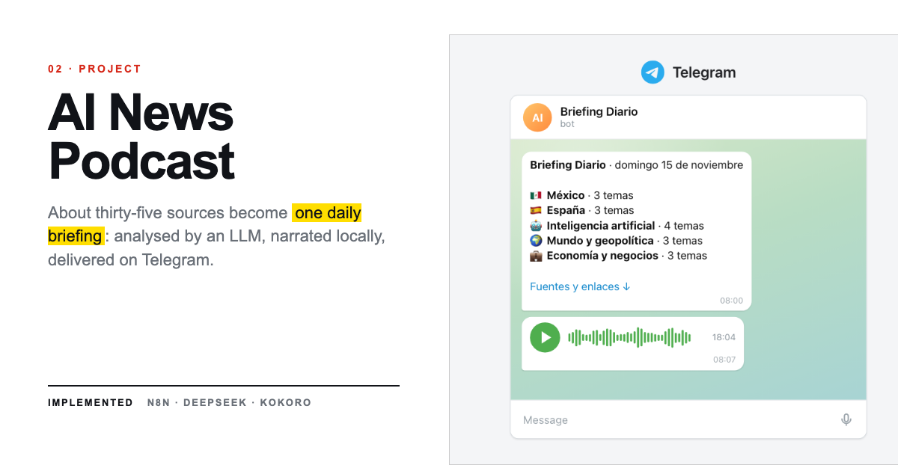
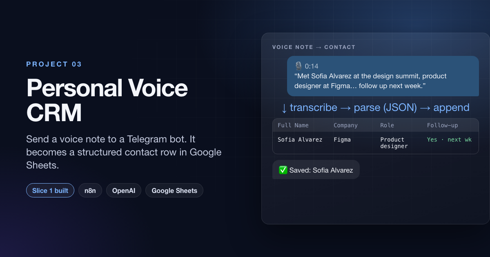
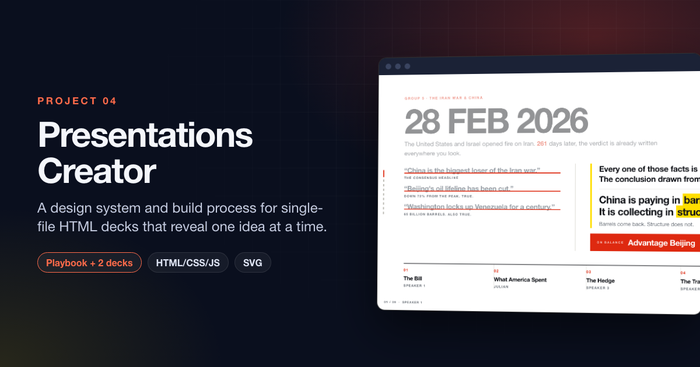
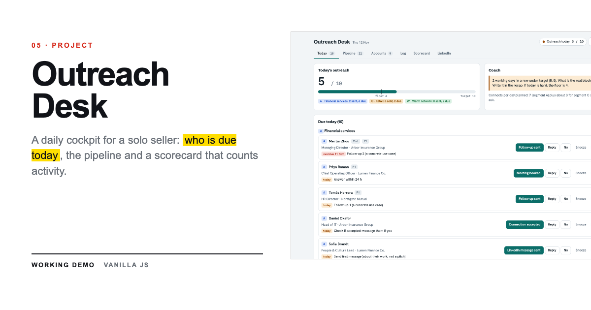
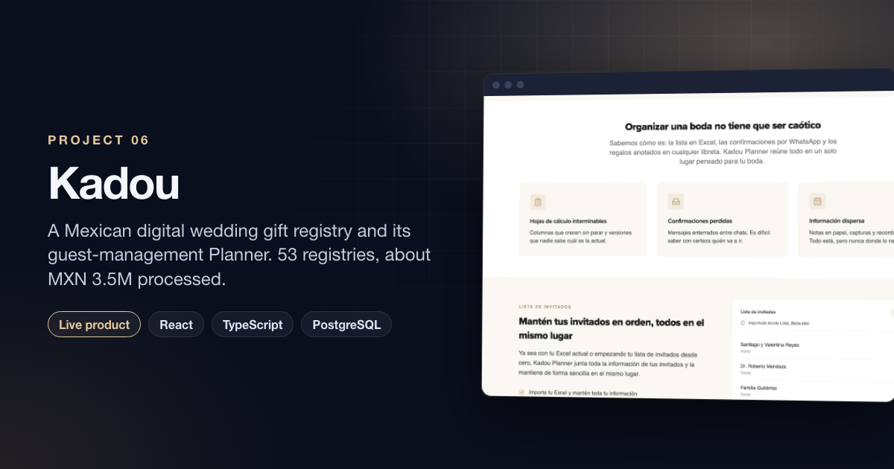

 

**A log of the AI systems I have built: what each one does, how it works, what broke, and where it stands.**
 Four are reusable tools with their own repositories. Two are demos and case studies that live here.

[LinkedIn](https://www.linkedin.com/in/julianrevorio/) · [Kadou](https://kadou.mx)

---

## At a glance

| Number | What it is |
|:---:|:---|
| **6** projects | an automation pipeline, a daily AI podcast, a voice CRM, a deck system, a sales cockpit and a live product |
| **53** registries · **~MXN 3.5M** processed | on [Kadou](projects/kadou-case-study/), the wedding gift platform I built and run |
| **~1,900** lines of Python | in the Video Clipper, running 100% locally with no paid APIs |
| **35** news sources → **1** daily audio briefing | in the AI News Podcast, from RSS to a Telegram voice note |

## Tools: one repository each

Things you can install, run and reuse.

<table>
<tr>
<td width="50%" valign="top">

<b><a href="https://github.com/julianreves/video-clipper">Video Clipper</a></b> 
Long interview in, 30–45 s captioned clips out, in 16:9 and 4:5. Cuts land inside real pauses; quotes are machine-checked against the speech.
</td>
<td width="50%" valign="top">

<b><a href="https://github.com/julianreves/ai-news-podcast-n8n">AI News Podcast</a></b> 
~35 RSS feeds become a daily audio briefing (editorial target: about 18 minutes): LLM selection, analysis and script, local TTS, delivered on Telegram, with cost tracking and failure alerts.
</td>
</tr>
<tr>
<td width="50%" valign="top">

<b><a href="https://github.com/julianreves/personal-voice-crm">Personal Voice CRM</a></b> 
Speak a contact into Telegram; get a structured row in Google Sheets. Design reviewed before building, with the bugs found in the first spec documented.
</td>
<td width="50%" valign="top">

<b><a href="https://github.com/julianreves/presentations-creator">Presentations Creator</a></b> 
A written design system, process and QA checklist for single-file HTML decks, with two reference decks you can open and click through.
</td>
</tr>
</table>

## Demos and case studies: in this repository

<table>
<tr>
<td width="50%" valign="top">

<b><a href="projects/outreach-desk/">Outreach Desk</a></b> 
A daily outreach cockpit for a solo seller: due list, pipeline board, target vs floor scorecard, LinkedIn analytics. Runs in the browser with demo data.
</td>
<td width="50%" valign="top">

<b><a href="projects/kadou-case-study/">Kadou</a></b> 
Case study of a live digital gift registry and its guest-management Planner: product, architecture, and how it was built safely with AI agents. Code is private.
</td>
</tr>
</table>

| Project | Stack | Status | When |
|---|---|---|---|
| [Video Clipper](https://github.com/julianreves/video-clipper) | Python, ffmpeg, Whisper, Pillow | Built and used; macOS only | Nov 2026 |
| [AI News Podcast](https://github.com/julianreves/ai-news-podcast-n8n) | n8n, DeepSeek, Kokoro TTS, Telegram | Implemented; hardening ongoing | Nov 2026 |
| [Personal Voice CRM](https://github.com/julianreves/personal-voice-crm) | n8n, OpenAI, Telegram, Google Sheets | Slice 1 built; the rest is designed | Jul 2026 |
| [Presentations Creator](https://github.com/julianreves/presentations-creator) | HTML, CSS, JS, SVG | Playbook and two decks; no template yet | Sep 2026 |
| [Outreach Desk](projects/outreach-desk/) | Vanilla JS | Working demo | Nov 2026 |
| [Kadou](projects/kadou-case-study/) | React, TypeScript, Express, PostgreSQL | Live product; case study only | 2025–2026 |

## What ties them together

- **Reliability is part of the work.** A green step is not a delivered result: the podcast validates the *content* of API responses, not just the HTTP status; the clipper lints specs before a ten-minute build; the CRM confirms every capture.
- **Design before build.** Specs, decision logs and "what failed" sections sit next to the code, because that is where most of the learning was.
- **People stay in the loop.** Nothing here posts publicly or spends money on its own. Anything that goes out is reviewed by a person first; the automations only report back to their owner.
- **Honest status.** "Slice 1 built" means exactly that, and designs are labelled as designs.

## What is not here

Client work, anything under NDA, customer data, credentials and private pipelines are deliberately left out. Where a tool was used with real data, the repository contains the tool and fictional or sample data only.

## Licence

| Part | Licence |
|---|---|
| Outreach Desk and everything else in this repository | [MIT](LICENSE) |
| Kadou case study (`projects/kadou-case-study/`) | [All rights reserved](projects/kadou-case-study/LICENSE) |

Each tool repository carries its own licence: MIT, and CC BY 4.0 for the example decks in Presentations Creator.

Built by <a href="https://www.linkedin.com/in/julianrevorio/">Julián Revorio</a>

