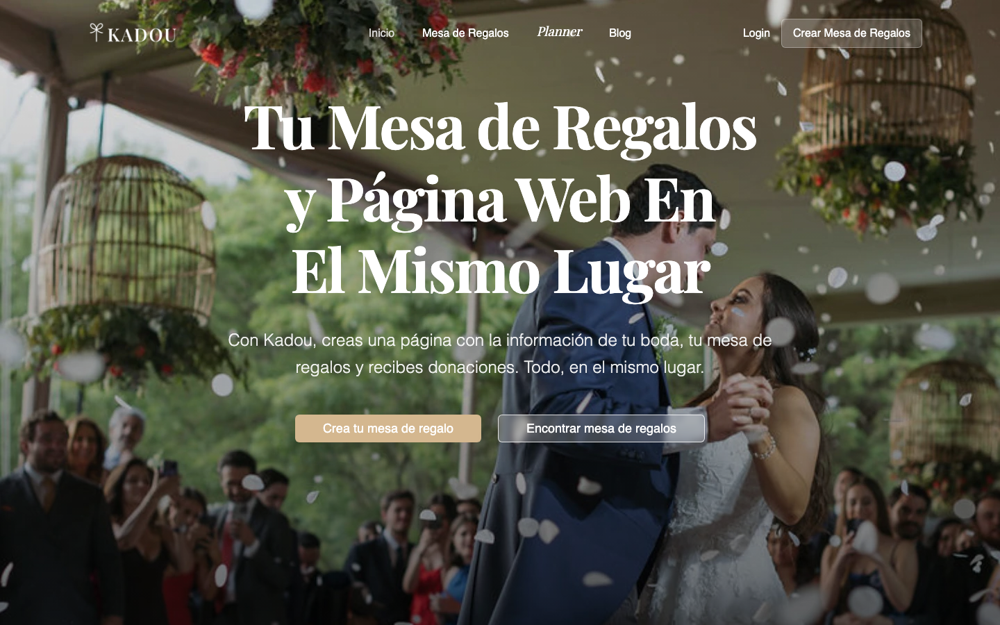
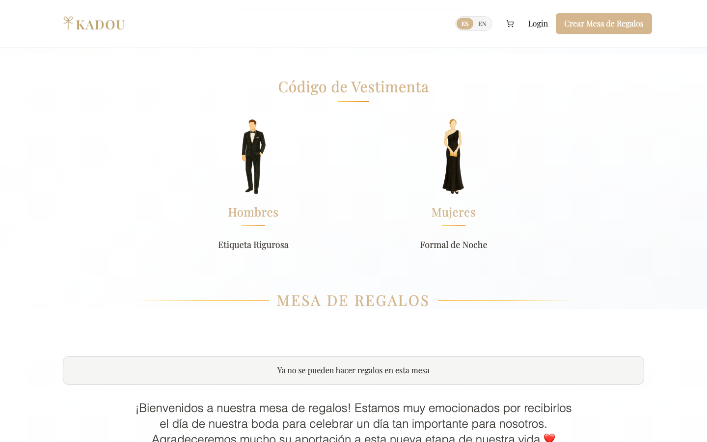
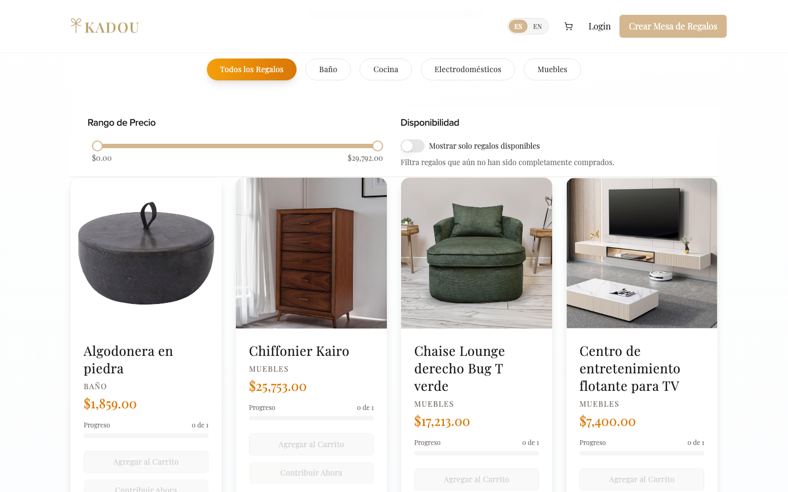
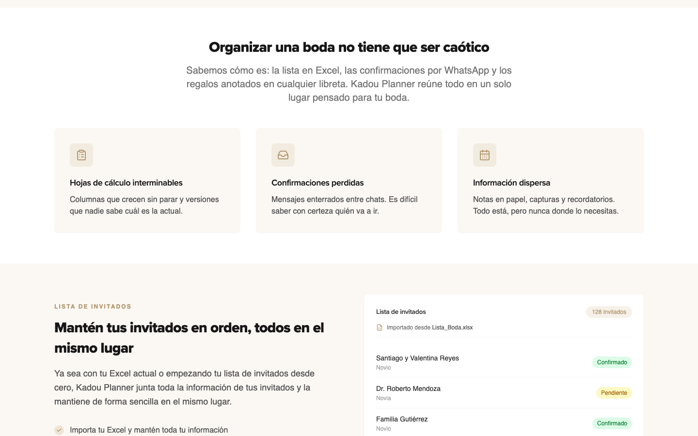
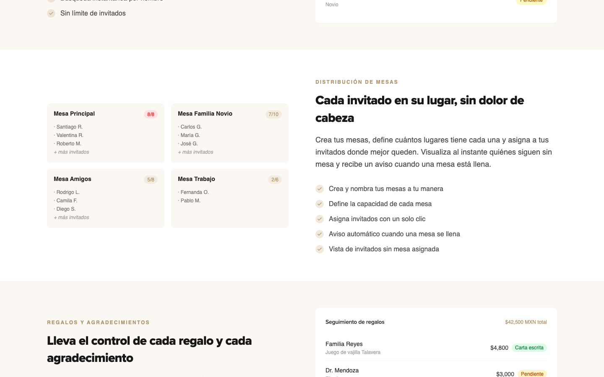
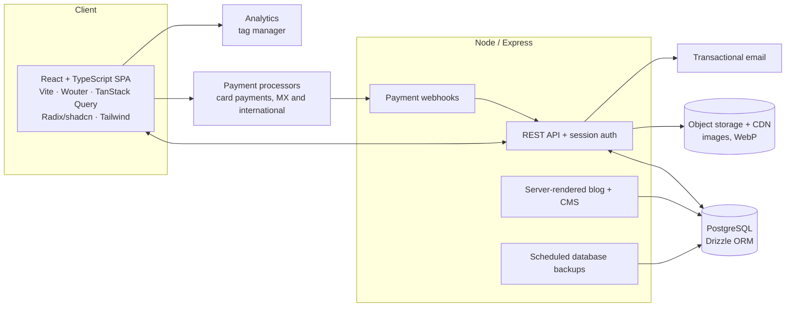
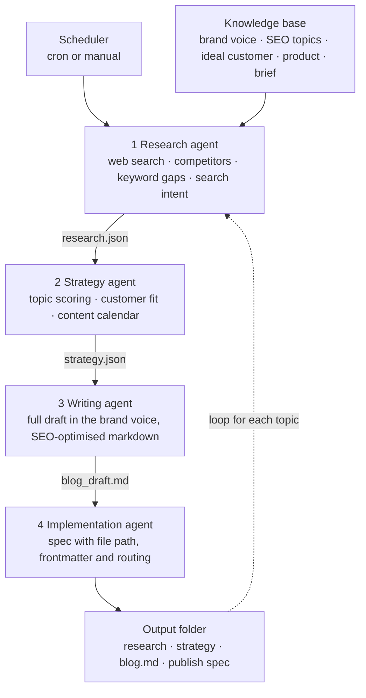

# Kadou: a digital wedding gift registry, and its Planner

**Case study.** Kadou ([kadou.mx](https://kadou.mx)) is a Mexican wedding platform: couples build a page with their wedding details and a gift registry, and guests contribute cash digitally. This write-up covers the product, how it is built, how it was built with AI coding tools, and what it has processed.

**The source code is private and is not part of this repository.** This is a case study: product, architecture, process and results. The screenshots come from public pages: the marketing site and a demonstration registry, with no customer data.

## The problem

Couples in Mexico traditionally rely on department-store registries or cash envelopes. They end up with a spreadsheet of guests, RSVPs scattered across WhatsApp chats and gifts noted in a notebook. Guests, in turn, have no easy way to give money in a way that feels personal.

## The product

**Registry (the core).** A couple creates an account, adds their wedding details and a cover image, and sets up a registry of symbolic gift concepts or contribution categories (a honeymoon dinner, a first-home fund). No physical products are shipped: everything contributed becomes cash the couple can withdraw to their bank account. Guests open the couple's page, pick a concept, pay by card and get a confirmation; the couple watches contributions arrive and requests a withdrawal.

**Kadou Planner (free with every registry).** A guest-management tool built on top, with four sections:

| Section | What it does |
|---|---|
| **Overview** | Counts and progress at a glance: invited, confirmed, pending, seated, gifts received, thank-yous sent. |
| **Guests** | Guest list with RSVP status, side of the couple, relationship tags, plus-ones, notes. Import from an existing Excel/CSV, export back out. |
| **Tables** | Create tables, set each one's capacity, assign guests in a click, see who still has no table and get a signal when a table is full. |
| **Thank-yous** | Track each gift (what it was and its value) and whether the thank-you note has been written, so none is forgotten. |

A registry is a public page with the couple's wedding details (date, countdown, dress code) and a catalogue of gift concepts that guests can filter by category and price:

*(Both screenshots are from a demonstration registry, not a customer's.)*

*(Names and amounts in these screenshots are the sample data of the public landing page.)*

## Architecture

- **Frontend:** a React 18 + TypeScript single-page app with a luxury, editorial design system (serif headings, warm gold accents), responsive down to mobile, entirely in Spanish.
- **Backend:** Express with session-based authentication, a Drizzle ORM data layer on PostgreSQL, and separate admin and super-admin dashboards.
- **Payments:** card processing through two processors (one Mexican, one international), centred on a cart so every gift goes through the same flow, with webhooks to confirm outcomes and a fee calculator.
- **Content and SEO:** a server-rendered blog with its own content management, so articles are indexable without client-side rendering.
- **Operations:** scheduled database backups, images served as WebP from a CDN, analytics through a tag manager.
- **Size:** about 34,000 lines of TypeScript across client, server and shared code.

### Data model, at a glance

Two deliberately separate areas:

- **Money:** `users`, `registries`, `gifts`, `contributions`, `withdrawals`, `catalog_items`.
- **Planner:** `guests`, `wedding_tables` and two small lookup tables for relationship tags and sides of the couple.

The Planner was added later and is **not linked to the money tables**, so a bug in guest management can never touch a payment.

## How it was built

Kadou was built with an AI coding agent working from written specifications. The interesting part is the process, because it is what kept a real-money system safe while moving fast:

1. **Audit before change.** Before the Planner was specified, the live schema and code were reviewed, and the findings became hard rules in the spec.
2. **Additive-only changes.** New tables and new routes only. No edits to the money tables, no changes to existing storage methods or routes.
3. **No blind schema pushes.** The migration history had drifted from the ORM's own journal, so the specs forbid the ORM's automatic push against the live database and apply migrations explicitly instead.
4. **Specs carry the design system.** Every UI spec includes the colour tokens, fonts, spacing and component patterns, and a hard rule that all user-facing text is Spanish, so generated screens match the existing site.
5. **Spec per concern.** Separate specs for the guest CRM, the Planner landing page, an analytics clean-up (fixing a placeholder page title that polluted page-view reporting, a blog with no tracking, and missing UTM capture and conversion events) and a blog build.

### A content pipeline for the blog

The blog is fed by a small multi-step content pipeline: a research step (web search, competitors, keyword gaps), a strategy step (topic scoring against the ideal customer profile), a writing step (a full draft in the brand voice) and an implementation step that produces the exact spec to publish the post. It runs from a knowledge base of five documents (brand voice, SEO topics, ideal customer profile, product and brief).

## Results

As of November 2026:

| Metric | Value |
|---|---|
| Registries created | **53** |
| Total value processed | **about MXN 3.5 million** |

## What I would do differently *(draft: edit to your own view)*

- Reconcile the migration history with the ORM's journal from day one, so the safe path and the default path are the same path.
- Put analytics events in the first spec, not in a clean-up after launch.
- Add an automated test around the payment and withdrawal flow before adding any feature next to it.

## Licence

All rights reserved. This folder is shown for reading only; see [LICENSE](LICENSE).

## What is not in this repository

The source code and all customer data (names, photos and personal details) are not included.
