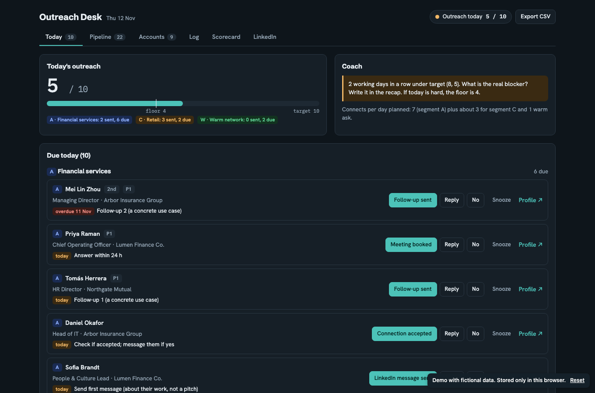
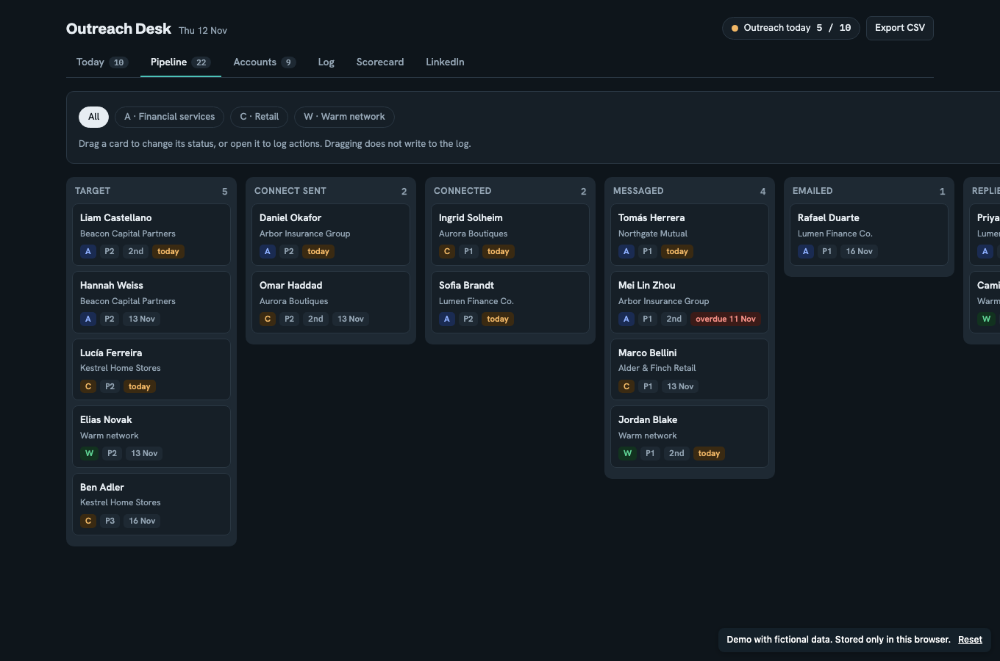
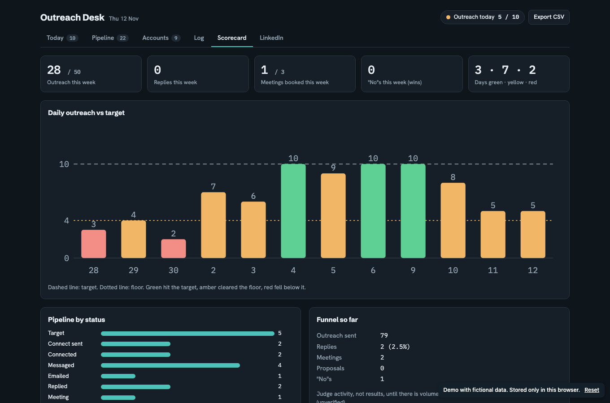
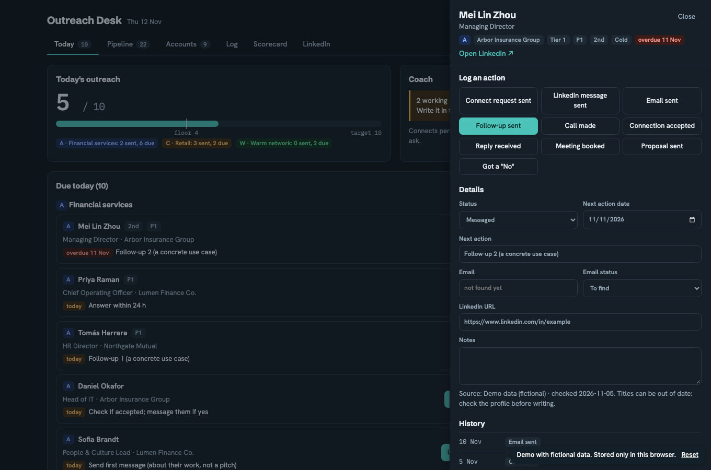
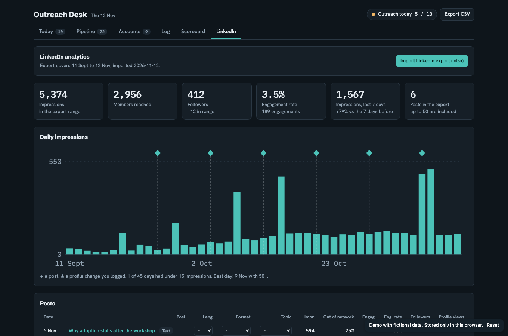

# Outreach Desk

A single-page **daily outreach tracker and coach for a solo seller**. It answers three questions every morning: *who is due today, how many touches have I made against my target, and what is the next step for each lead*. It also keeps a pipeline, an activity log, a scorecard and a LinkedIn analytics view in one place.

It is one HTML file of vanilla JavaScript (~800 lines, no build step). **The data in this repository is fictional**; the author's real pipeline is not included.



## Try it

Open [`outreach-desk.html`](outreach-desk.html) in a browser (from the folder, so it finds `demo-backend.js`). It loads with demo data. Add `?reset` to the URL to restore the demo data, or `?today=2026-11-12` to pretend it is another day (the demo data is generated relative to today). A small banner reminds you that the data is fictional and lives only in your browser.

## What it does

| Tab | What it is for |
|---|---|
| **Today** | Everything due today or overdue, grouped by segment, each with one-click actions: log the next step, mark a reply, record a "No", snooze. A progress meter shows today's outreach against a **target** and a **floor**, and a one-line *coach* reacts to the pattern (e.g. several days in a row under target). |
| **Pipeline** | A board by status (Target → Connect sent → Connected → Messaged → Emailed → Replied → Meeting → Proposal → Won / Lost / Nurture). Drag a card to change status, or open its drawer to log actions and edit details. |
| **Accounts** | Companies with a tier, size evidence, context and the people mapped to each. |
| **Log** | Every logged action as a feed, filterable by segment and event, with undo and manual entries. |
| **Scorecard** | Daily outreach against target and floor, week totals, a funnel and pipeline by status. |
| **LinkedIn** | Import LinkedIn's analytics export (`.xlsx`) to see impressions, followers, daily chart with posts marked, audience quality, per-post stats, a Spanish-vs-English test, and a log of inbound signals. |





## Design ideas worth noting

- **Judge activity, not results, until there is volume.** Early on a seller has too few replies to learn from, so the scorecard and the coach measure leading indicators: touches per day, follow-ups done, meetings booked.
- **A floor for bad days.** Alongside the target there is a minimum ("a minimal day, never a zero day"). Clearing the floor counts, and the coach points to it when the day is going badly.
- **Every "No" is a data point.** Logging a "No" takes one click, records a reason, and counts as a win on the scorecard, so rejection is not avoided by not logging.
- **The cadence is encoded, not remembered.** Logging an action computes the next one: a connection request is checked after 4 business days; a first message gets a follow-up after 3; follow-up 2 after 4; a closing-the-loop message after 7; then the lead moves to *Nurture* for 60 business days. A reply or booked meeting resets the next step to "answer within 24 h" or "prepare discovery questions". See `transition()` in the source.
- **Undo when logging.** Logging an action shows a toast with an undo that restores the previous contact state and removes the log entry.
- **Writes are queued per document**, so rapid clicks cannot overwrite each other.



## How the data layer works

The page was first built to run inside a host that provides a small document database, and talks to it through a tiny API (`collection`, `doc`, `add`, `set`, `update`, `delete`, `orderBy`, `limit`, `onSnapshot`). [`demo-backend.js`](demo-backend.js) implements that same API on top of `localStorage` and seeds it with generated fictional data, so the page runs on its own with no server. Changes to the app code itself are limited to neutral wording and a LinkedIn-URL regex that no longer contains a personal username.



## Limitations

- Single user, single browser: data lives in `localStorage` and does not sync.
- The LinkedIn import depends on the layout of LinkedIn's analytics export at the time it was written, and loads the SheetJS parser from a CDN. There is no sample export in this repository, so the import path is not covered by the demo.
- A few labels and matchers in the LinkedIn audience view are tuned to the author's market (a target city, company sizes of 51–500, buyer job titles). Change them in `viewLinkedIn` for another market.
- The demo's activity log is randomly generated, so individual events do not always match a contact's current status.
- Web fonts are loaded from Google Fonts; offline it falls back to system fonts.

## Files

```
outreach-desk.html    the app
demo-backend.js       localStorage implementation of the data API + fictional seed data
screenshots/          captured from the demo data
```
