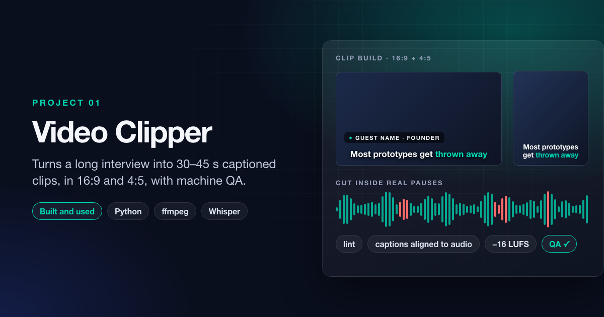
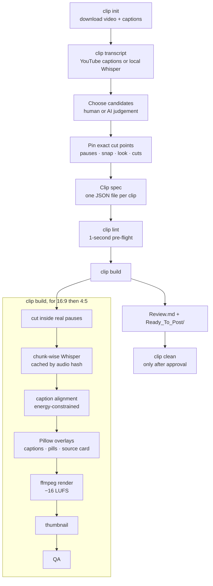

# Video Clipper



A local pipeline that turns a long interview or talk into **short, captioned clips for LinkedIn**: 30–45 seconds, opening on the strongest line, rendered twice (16:9 and a 4:5 crop that follows the speaker), with a machine QA pass at the end.

It is a command line tool (`clip`) plus ~1,900 lines of Python and ffmpeg glue. Everything runs on your own machine: no paid APIs, no uploads, nothing is published automatically.

**Status:** built and used for real clips. macOS only for now (it uses the system Helvetica Neue font and a macOS yt-dlp binary). It has not been packaged or tested on a clean machine, so treat the setup below as a starting point, not a guarantee.

## What it does



Each finished clip gets two videos (`NN_Title.mp4` 1920×1080 and `NN_Title_4x5.mp4` 1080×1350), thumbnails, an `.srt`, and a `Review.md` that lists everything a human should check before posting: every join to listen to, every caveat, post-length and style warnings.

## The parts worth reading

- **Cuts land inside real pauses, found from audio energy** (`clip pauses`, `clip snap`), not from caption timestamps, which drift by ±0.3–0.6 s around pauses. [`lib/explore.py`](Toolkit/lib/explore.py)
- **Caption timing is aligned against audio energy** with a dynamic-programming pass, then validated against an independent re-transcription (median deviation 0.11–0.17 s). The build prints the deviation so a misplaced caption set is visible. [`lib/captions.py`](Toolkit/lib/captions.py)
- **Quotes are machine-checked.** Anything shown in quotation marks must be words actually spoken in the clip, verified against the clip's own transcript and the platform's captions. [`lib/check.py`](Toolkit/lib/check.py)
- **`clip lint` fails fast.** Bad cut points, non-verbatim quotes and missing anchors are caught in about a second, before the ~10-minute build. [`lib/lint.py`](Toolkit/lib/lint.py)
- **A cache and a lock make rebuilds cheap and safe.** Whisper results are cached by audio hash, and only one heavy job runs at a time (two Whisper models at once thrashed an 8 GB machine). [`bin/clip`](Toolkit/bin/clip)
- **4:5 reframing follows the speaker.** The spec lists where the speaker sits in each shot; the crop window moves with them. [`lib/build_base.py`](Toolkit/lib/build_base.py)
- **The overlay is drawn with Pillow into an RGBA frame sequence**, because the available ffmpeg build has no text filters. [`lib/overlays.py`](Toolkit/lib/overlays.py)
- **[`Toolkit/LESSONS.md`](Toolkit/LESSONS.md)** is the honest part: mistakes that happened (a wrong speaker, a dropped word that QA could not detect, a 4-hour job that was 85% waiting) and what changed because of them.

## Design rules

1. Everything runs locally: ffmpeg, Pillow, faster-whisper, yt-dlp.
2. **Never publish anything automatically.** A human reviews and posts.
3. **No invented quotes, stats or facts.** Quotes and on-screen text are verbatim speech.
4. **Never delete without approval.** `clip clean` is a dry run unless `--yes`.
5. The tool cannot hear audio, so it says what it verified and what it could not.

## Setup (macOS)

Requirements: `ffmpeg` and `ffprobe` on the PATH, Python 3, and two Python environments the CLI looks for under `Toolkit/env/`:

| Path | Needs | Used for |
|---|---|---|
| `Toolkit/env/venv` | `pillow` | overlays, thumbnails |
| `Toolkit/env/venv39` | `faster-whisper`, `numpy` | transcription, QA |

They are separate because the transcription stack was pinned to Python 3.9 on the author's machine. If one environment has all three packages, point both paths at it (`ln -s venv Toolkit/env/venv39`).

> **Known gotcha:** `faster-whisper` depends on `av`, which failed to build on a Python 3.15 pre-release in a quick test. Use a released Python for the transcription environment (the author uses 3.9).

```bash
cd projects/video-clipper/Toolkit
python3 -m venv env/venv && env/venv/bin/pip install pillow
/path/to/python3.9 -m venv env/venv39 && env/venv39/bin/pip install faster-whisper numpy
bin/clip doctor      # checks tools; downloads the standalone yt-dlp binary if missing
```

The Whisper model (`medium.en`, ~1.5 GB) downloads on first use into `~/.cache/huggingface`.

## Usage

```bash
bin/clip init "<youtube url>"        # creates Jobs/<date>_<slug>/ with video + captions
bin/clip transcript                  # readable, timestamped transcript
bin/clip pauses 800 830              # real pauses in a source range (cut candidates)
bin/clip look 800 830                # contact sheet: who is on screen and speaking?
bin/clip new My_Clip                 # scaffold clips/01.json from the template
bin/clip lint all                    # pre-flight, ~1 second
bin/clip build todo                  # 16:9 + 4:5, captions, QA
bin/clip preview 01                  # contact sheet of the rendered clip
bin/clip report                      # Review.md + Ready_To_Post/
bin/clip clean --yes                 # after approval: delete everything but the finished posts
```

A clip is described by one JSON spec. See [`Toolkit/SPEC_REFERENCE.md`](Toolkit/SPEC_REFERENCE.md) for every field and [`Toolkit/examples/example_spec.json`](Toolkit/examples/example_spec.json) for an illustrative one (fictional speaker, placeholder times). The look is documented in [`Toolkit/STYLE_GUIDE.md`](Toolkit/STYLE_GUIDE.md).

Typical numbers on an M1 with 8 GB: a 34-second clip builds in about 3.6 minutes for 16:9 with a cold Whisper cache plus about 0.7 minutes for the 4:5 version; rebuilds take about 1.3 minutes for both.

## A note on source material

The repository contains the tool only, no video, audio, captions or transcripts. When you clip someone else's interview, you are responsible for having the right to do so: keep the source attribution the pipeline adds (the closing card names guest, host and channel), do not alter meaning, and take a clip down if its owner asks.
